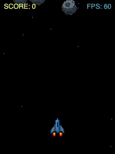

# TS Canvas Game Template

TypeScript template for simple Canvas 2D browser games. Not a full game engine or framework... yet.

## Structure

| Folder      | Purpose                                                             |
|-------------|---------------------------------------------------------------------|
| `src/core/` | Generic, game-agnostic code - can be copied 1:1 into a new project. |
| `src/game/` | Game-specific code - intended to be replaced or extended.           |

### Core files

| File         | Purpose                                              |
|--------------|------------------------------------------------------|
| `loop.ts`    | The game loop runner.                                |
| `render.ts`  | Textures, sprites, animations and rendering helpers. |
| `objects.ts` | Game objects container and collision detection.      |
| `input.ts`   | Keyboard and mouse/touch input.                      |
| `audio.ts`   | Music and sound effects.                             |

### Core classes

| Class               | Purpose                                            |
|---------------------|----------------------------------------------------|
| `GameLoop`          | Runs the show.                                     |
| `GameObject`        | Base game object entity.                           |
| `GameObjectManager` | Stores and manages all in-game objects.            |
| `CollisionManager`  | Detects and handles collisions.                    |
| `TextureManager`    | Loads and caches images.                           |
| `Animation`         | Manages sprite-sheet animations.                   |
| `RenderHelper`      | Canvas helpers: text, debug box, sprite rendering. |
| `InputManager`      | Handles keyboard and pointer input.                |
| `AudioManager`      | Loads and plays sound effects.                     |

## Demo game

`src/game/` is a proof-of-concept Asteroids-style game with a spaceship, asteroids, missiles, explosions, sounds, a scrolling background and score tracking.

## Development

| Action               | Command           |
|----------------------|-------------------|
| Install dependencies | `npm install`     |
| Run tests            | `npm test`        |
| Compile TS to JS     | `npx tsc`         |
| Run in browser       | Open `index.html` |
